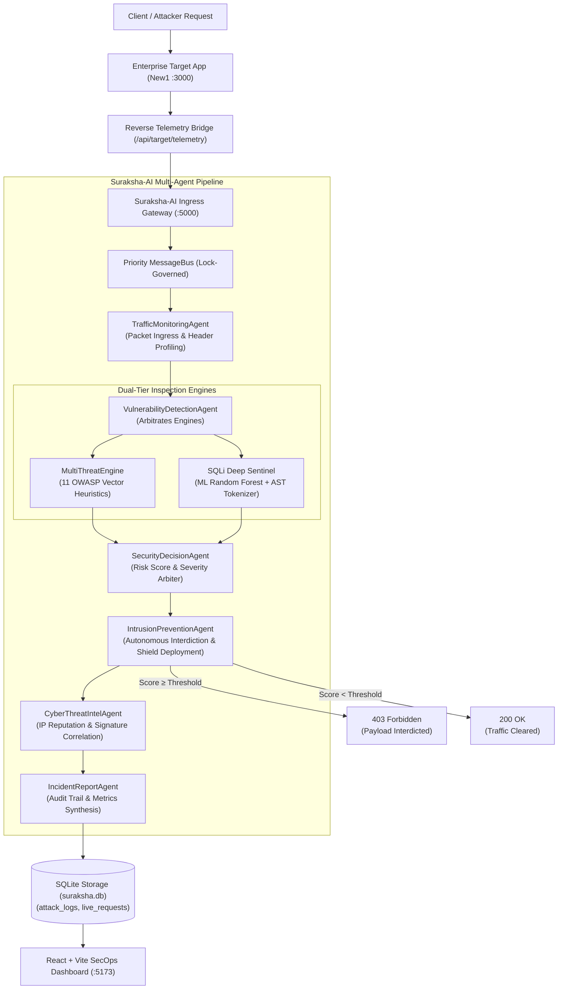
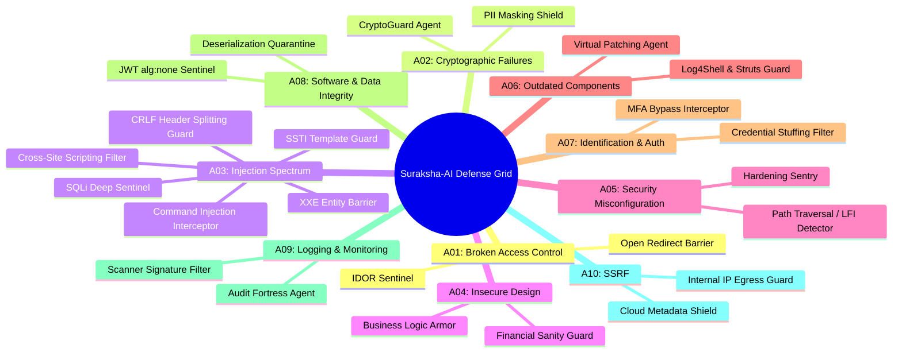

# 🛡️ Suraksha-AI: Autonomous Multi-Agent Web Defense Framework

> **AI-Powered Autonomous Web Application Firewall (WAF) & OWASP Top 10 Real-Time Interception Grid**

[](https://www.python.org/)
[](https://reactjs.org/)
[](https://vitejs.dev/)
[](https://flask.palletsprojects.com/)
[](https://owasp.org/Top10/)
[](LICENSE)

---

## 📌 Table of Contents
1. [Executive Overview](#-executive-overview)
2. [High-Level Architecture & Request Flow](#-high-level-architecture--request-flow)
3. [The Multi-Agent Defense Grid](#-the-multi-agent-defense-grid)
   - [Tier 1: Core System Autonomous Agents](#tier-1-core-system-autonomous-agents)
   - [Tier 2: Specialized OWASP Multi-Threat Sentinels](#tier-2-specialized-owasp-multi-threat-sentinels)
4. [Hybrid AI & Detection Engine](#-hybrid-ai--detection-engine)
5. [Subsystems & Port Ecosystem](#-subsystems--port-ecosystem)
6. [Repository & Directory Structure](#-repository--directory-structure)
7. [Installation & Quick Start](#-installation--quick-start)
8. [Testing & Attack Simulation Handbook](#-testing--attack-simulation-handbook)
9. [REST API Reference](#-rest-api-reference)
10. [Technical Reports & Documentation Hub](#-technical-reports--documentation-hub)
11. [Future Roadmap & Milestones](#-future-roadmap--milestones)

---

## 📖 Executive Overview

**Suraksha-AI** is a next-generation autonomous cybersecurity framework designed to defend modern web applications and APIs against the entire spectrum of the **OWASP Top 10 (2021)** security risks. 

Traditional Web Application Firewalls (WAFs) rely on rigid, static regex rule sets that are vulnerable to obfuscation, polyglot encoding, and zero-day bypasses. **Suraksha-AI** bridges this gap by unifying:
1. **Multi-Agent AI Collaboration**: A stateful, priority-driven network of cooperating autonomous defense agents (`Monitoring`, `Detection`, `Decision`, `Prevention`, `ThreatIntel`, `Reporting`).
2. **Hybrid Machine Learning**: Ensembles of TF-IDF vectorized Random Forest, Gradient Boosting, and AST grammar tokenizers for sub-millisecond voting classification.
3. **Multi-Threat Heuristic Engine**: Real-time inspection for 11 distinct threat vectors (SQLi, IDOR, SSRF, XSS, Command Injection, XXE, SSTI, Crypto Failures, Misconfigurations, Outdated Components, and Header Injection).
4. **Active Reverse Telemetry Bridge**: Seamless zero-code integration protecting microservices and target enterprise platforms (`New1`) with automated 403 interdiction.

---

## 🏛️ High-Level Architecture & Request Flow



---

## 🤖 The Multi-Agent Defense Grid

Suraksha-AI utilizes a two-tier agent architecture where autonomous threads communicate via a priority-enqueued singleton `MessageBus`.

### Tier 1: Core System Autonomous Agents

| Agent Name | Class / Source | Thread Priority | Role & Core Responsibilities |
| :--- | :--- | :--- | :--- |
| **Traffic Monitoring Agent** | `MonitoringAgent` | `High` | Continuously monitors packet ingress rates, parses HTTP headers/cookies, and extracts client fingerprints. |
| **Vulnerability Detection Agent** | `DetectionAgent` | `Critical` | Orchestrates the payload inspection across both heuristic rule sets and ML predictors. |
| **Security Decision Agent** | `DecisionAgent` | `Critical` | Evaluates threat confidence against operational risk thresholds and assigns final severity ratings (`Low`, `Medium`, `High`, `Critical`). |
| **Intrusion Prevention Agent** | `PreventionAgent` | `Critical` | Enforces active WAF shields, blocks malicious transactions (HTTP 403), and quarantines offending sessions. |
| **Cyber Threat Intel Agent** | `ThreatIntelAgent` | `Medium` | Analyzes historical attacking IPs, correlates repeat offenders, and tracks multi-vector campaigns. |
| **Incident Report Agent** | `ReportAgent` | `Low` | Asynchronously writes detailed audit records to the database and computes security metrics. |
| **Adversarial Simulation Agent** | `PayloadGeneratorAgent` | `Low` | Generates mutated, polyglot attack payloads for internal red-teaming and defense benchmarking. |

---

### Tier 2: Specialized OWASP Multi-Threat Sentinels

Every request is evaluated by 11 specialized heuristic sentinels configured inside `MultiThreatEngine`:



---

## 🧠 Hybrid AI & Detection Engine

Suraksha-AI combines deterministic grammar parsers with probabilistic machine learning for sub-millisecond threat interdiction:

### 1. Dual TF-IDF Feature Engineering
- **Character N-grams `(3, 5)`**: Captures sub-string syntax markers, brackets, and encoded characters.
- **Word N-grams `(1, 3)`**: Identifies keyword combinations (e.g. `UNION SELECT`, `OR 1=1`).
- **Statistical Descriptors**: Shannon Entropy of characters, length ratios, comment frequencies (`--`, `/*`, `#`), and special symbol counts.

### 2. Weighted Voting Ensemble Formula
The machine learning confidence probability is derived via:
$$\text{ML Probability} = 0.35 \times P_{\text{RF}} + 0.25 \times P_{\text{GB}} + 0.25 \times P_{\text{XGB}} + 0.15 \times P_{\text{LSTM}}$$

- **Random Forest ($P_{\text{RF}}$)**: 100 decision trees trained for fast, parallel inference.
- **Gradient Boosting ($P_{\text{GB}}$)**: Sequential boosted tree estimator for high-precision validation.
- **XGBoost ($P_{\text{XGB}}$)**: Extreme gradient boosting tree model.
- **Neural Tokenizer ($P_{\text{LSTM}}$)**: Recurrent character-level sequence fallback.

### 3. Behavioral Analyzers
- **Time-Based Delay Correlation**: Correlates delay commands (`SLEEP()`, `pg_sleep()`, `WAITFOR DELAY`) with actual measured execution latency.
- **Error-Based Leakage Parser**: Detects leaked database exceptions (MySQL, PostgreSQL, Oracle, SQLite, MSSQL).
- **Out-of-Band (OOB) Detector**: Catches outbound network triggers (`UTL_HTTP`, `xp_dirtree`, `LOAD_FILE`).

---

## 🌐 Subsystems & Port Ecosystem

| Subsystem | Port / Gateway | Technologies | Description |
| :--- | :--- | :--- | :--- |
| **Backend REST API** | `http://localhost:5000` | Python 3.11, Flask, SQLAlchemy, JWT | Core detection pipeline, reverse telemetry ingress, database API, and multi-agent bus. |
| **Frontend SecOps Dashboard** | `http://localhost:5173` | React 18, Vite 8, Tailwind CSS, Recharts | Security operations cockpit: live threat telemetry feeds, analytics radar, logs, and payload generator. |
| **Enterprise Target App (New1)** | `http://localhost:3000` | Node.js 20, Express, SQLite3, SSE | Production target portal (financial ledger & directory) protected by Suraksha-AI real-time WAF telemetry. |

---

## 📂 Repository & Directory Structure

```text
Suraksha-AI_Project_Phase1/
├── Backend/                            # Flask REST API & Multi-Agent Framework
│   ├── agents/                         # Multi-Agent Core Engine
│   │   ├── base/base_agent.py          # BaseAgent threading parent class
│   │   ├── communication/              # Thread-safe Priority MessageBus
│   │   ├── memory/                     # Rolling short/long-term agent memory
│   │   ├── orchestrator/               # Agent lifecycle coordinator
│   │   ├── plugins/                    # Core Agent plugins (monitoring, detection, etc.)
│   │   └── config.json                 # Agent enabled list and priority configuration
│   ├── ai/                             # Machine Learning & Multi-Threat Engines
│   │   ├── datasets/                   # OWASP Top 10 dataset (97 benchmark vectors)
│   │   ├── models/                     # Serialized Random Forest, XGBoost, and TF-IDF models
│   │   ├── predictors/ensemble.py      # Weighted voting ensemble classifier
│   │   └── utils/                      # MultiThreatEngine, RuleEngine, Behavioral detectors
│   ├── app/                            # Flask application factory, blueprints, and models
│   │   ├── models/attack_log.py        # AttackLog ORM model with full threat serialization
│   │   ├── routes/target.py            # /api/target/telemetry reverse WAF bridge
│   │   └── services/detection_service  # Unified detection pipeline & arbiter
│   ├── run.py                          # Flask application entry point (:5000)
│   └── requirements.txt                # Python package dependencies
│
├── Frontend/                           # React + Vite SecOps Dashboard (:5173)
│   ├── src/
│   │   ├── components/                 # Reusable UI widgets (Cards, Tables, Modals, Pagination)
│   │   ├── pages/
│   │   │   ├── Dashboard.jsx           # Live Threat Overview & Real-Time Threat Feed
│   │   │   ├── ThreatAnalytics.jsx     # Upgraded Threats section with full multi-vector audit table
│   │   │   ├── AttackLogs.jsx          # Historical incident search and CSV export
│   │   │   ├── MultiThreatScanner.jsx  # Interactive live testing sandbox
│   │   │   └── PayloadGenerator.jsx    # Red-team test payload compiler
│   │   └── services/                   # Axios API clients and WebSocket/SSE handlers
│   └── package.json
│
├── New1/                               # Protected Enterprise Target Application (:3000)
│   ├── server.js                       # Express server with Suraksha-AI telemetry hook
│   ├── index.html                      # Enterprise banking & ledger interface
│   └── app.js                          # Real-time SSE attack fluctuation animations
│
├── reports/                            # Comprehensive Technical Architecture & Verification Guides
│   ├── suraksha_ai_defense_agents_report.md
│   ├── suraksha_ai_vulnerability_testing_guide.md
│   ├── easy_step_by_step_testing_demonstration.md
│   ├── multi_threat_detection_and_resolution_report.md
│   └── README.md                       # Reports directory documentation index
│
├── test_attack.py                      # Interactive 1-line CLI threat simulation tool
├── test_live_attacks.py                # Streaming multi-threat test runner
├── test_owasp_top10_suite.py           # 97-vector OWASP Top 10 compliance test suite
├── run_project.bat                     # 1-Click launcher starting all 3 services
└── README.md                           # Master Project Documentation (This File)
```

> ℹ️ *Note: All individual subsystem documentation files (`Backend/README.md`, `Backend/ai/README.md`, `Backend/agents/README.md`, `Frontend/README.md`, and `reports/README.md`) are preserved intact within their respective directories.*

---

## ⚡ Installation & Quick Start

### Prerequisites
- **Python 3.11+** installed and added to `PATH`.
- **Node.js 18+** and **npm** installed.

---

### Option A: 1-Click Launch (Recommended)
Run the automated batch script from the project folder:
```powershell
.\run_project.bat
```
This automatically starts:
1. **Backend REST API** on `http://localhost:5000`
2. **Frontend Dashboard** on `http://localhost:5173`
3. **Target Enterprise App** on `http://localhost:3000`

---

### Option B: Manual Service Startup

#### 1. Start the Flask Backend
```powershell
cd Backend
python -m venv venv
.\venv\Scripts\Activate.ps1
pip install -r requirements.txt
python run.py
```

#### 2. Start the React Frontend Dashboard
```powershell
cd Frontend
npm install
npm run dev
```

#### 3. Start the Target Application
```powershell
cd New1
npm install
node server.js
```

---

## 🧪 Testing & Attack Simulation Handbook

To test and verify that Suraksha-AI intercepts, blocks, and categorizes attacks across the full OWASP Top 10 spectrum, run these commands in your PowerShell or Command Prompt terminal from `Suraksha-AI_Project_Phase1`:

### 🎯 One-by-One Vector Attack Commands

| OWASP Vector | Test Command | Simulated Attack Behavior |
| :--- | :--- | :--- |
| **A01: Broken Access Control** | `python test_attack.py bac` | Privilege escalation (`user_id=1&role=admin&isAdmin=true`). |
| **A01: Open Redirect** | `python test_attack.py redirect` | Unvalidated external destination redirect (`redirect=https://evil.com`). |
| **A02: Cryptographic Failures** | `python test_attack.py crypto` | Insecure legacy cipher downgrade request (`cipher=DES&key_length=56`). |
| **A02: Unencrypted PII** | `python test_attack.py crypto-pii` | Request to store unencrypted Social Security Numbers in plaintext. |
| **A02: Unmasked Card Data** | `python test_attack.py crypto-export` | Exfiltration attempt for unmasked payment card numbers (`mask=false`). |
| **A03: SQL Injection** | `python test_attack.py sqli` | Tautology authentication bypass (`admin' OR 1=1 --`). |
| **A03: OS Command Injection** | `python test_attack.py command` | Shell metacharacter command execution (`127.0.0.1; whoami \| id`). |
| **A03: Cross-Site Scripting** | `python test_attack.py xss` | DOM session cookie stealing script (`<script>fetch(...)`). |
| **A03: Template Injection (SSTI)**| `python test_attack.py ssti` | Jinja2 Python sandbox escape (`{{config.__class__...}}`). |
| **A03: XML / XXE Injection** | `python test_attack.py xxe` | External DOCTYPE entity arbitrary file disclosure. |
| **A04: Insecure Design** | `python test_attack.py design` | Client-side price tampering and negative quantity (`quantity=-5`). |
| **A05: Security Misconfig** | `python test_attack.py misconfig` | Probing for exposed server environment files (`/.env`). |
| **A05: Path Traversal / LFI** | `python test_attack.py traversal` | Directory climbing sensitive file read (`../../../../etc/shadow`). |
| **A06: Outdated Components** | `python test_attack.py cve` | Log4Shell (`CVE-2021-44228`) JNDI lookup injection probe. |
| **A06: Apache Struts OGNL** | `python test_attack.py struts` | Apache Struts remote execution probe (`CVE-2017-5638`). |
| **A07: Identification & Auth** | `python test_attack.py auth` | Credential stuffing with common passwords and MFA bypass attempt. |
| **A07: MFA Parameter Bypass** | `python test_attack.py auth-mfa` | Parameter override probe attempting to skip 2FA validation. |
| **A08: Software & Data Integrity**| `python test_attack.py integrity` | Unsigned JWT token header tampering with `alg:none`. |
| **A08: Insecure Deserialization**| `python test_attack.py integrity-deserial`| Base64-encoded Java serialized object RCE probe. |
| **A09: Logging & Monitoring** | `python test_attack.py logging` | Malicious attempt to delete/tamper with audit logs (`DELETE FROM audit_logs`). |
| **A09: Scanner Signature** | `python test_attack.py logging-scanner` | Automated reconnaissance vulnerability scanner signature (`sqlmap`). |
| **A10: SSRF** | `python test_attack.py ssrf` | Cloud metadata service credential harvesting (`169.254.169.254`). |

---

### 🚀 Automated Test Suites
- **Run all attack vectors automatically in sequence:**
  ```powershell
  python test_attack.py all
  ```
- **Run live attack traffic stream with visual delay:**
  ```powershell
  python test_live_attacks.py --delay 1.0
  ```
- **Run the full 97-vector OWASP Top 10 compliance benchmark:**
  ```powershell
  python test_owasp_top10_suite.py
  ```

---

## 📡 REST API Reference

All backend endpoints are rooted under `http://localhost:5000/api`.

### Standard Response Envelope
```json
{
  "success": true,
  "message": "Descriptive status text",
  "data": {},
  "timestamp": "2026-11-14T13:00:00Z",
  "status_code": 200
}
```

### Core Endpoints

#### 1. System Health Check
- **`GET /api/health`**
- Returns CPU, memory, and database connectivity status.

#### 2. Reverse Telemetry Ingress (WAF Gate)
- **`POST /api/target/telemetry`**
- Evaluates inbound request details from target apps and returns 403 Forbidden on malicious payloads.
- **Payload Schema:**
  ```json
  {
    "source_app": "Production API",
    "url": "/api/render/template",
    "method": "POST",
    "payload": "{{config.__class__.__init__.__globals__['os'].popen('whoami').read()}}",
    "client_ip": "198.51.100.12"
  }
  ```

#### 3. Security Analytics & Trends
- **`GET /api/analytics/overview`**
- Provides weekly intrusion containment counts, six-month telemetry matrix, and threat distribution numbers.

#### 4. Attack Logs Ledger
- **`GET /api/logs?page=1&per_page=50&level=CRITICAL`**
- Paginated, filterable audit log database of all intercepted threats.

#### 5. Multi-Threat Direct Payload Evaluation
- **`POST /api/multi-threat/scan-payload`**
- Direct testing endpoint used by the SecOps web UI scanner.

---

## 📑 Technical Reports & Documentation Hub

Deep-dive documentation and research papers are available inside the [`reports/`](./reports) directory:

1. [**Suraksha-AI Defense Agents & Operations Report**](./reports/suraksha_ai_defense_agents_report.md)  
   *Complete agent lifecycle, priorities, message bus synchronization, and latency profiles.*
2. [**Vulnerability Verification & Defense Testing Guide**](./reports/suraksha_ai_vulnerability_testing_guide.md)  
   *97-vector OWASP Top 10 benchmarking methodology and AST inspection targets.*
3. [**Simple Step-by-Step Testing Demonstration**](./reports/easy_step_by_step_testing_demonstration.md)  
   *Plain-English testing guide and UI walkthrough for demonstrations and non-technical stakeholders.*
4. [**Multi-Threat Vector Classification & Resolution Report**](./reports/multi_threat_detection_and_resolution_report.md)  
   *Root-cause analysis and resolution for multi-vector threat categorization and dashboard synchronization.*

---

## 🔮 Future Roadmap & Milestones

- [x] **Phase 1: Multi-Threat Hybrid Detection & Agent Grid (Completed)**
  - Dual-tier ML + MultiThreatEngine integration.
  - Full OWASP Top 10 coverage with sub-millisecond interdiction.
  - Real-time modern SecOps Dashboard with dynamic vector audit table.
- [ ] **Phase 2: Active Deception & Autonomous Honeypots**
  - Implement `DeceptionAgent` to trap suspicious probing requests into virtual honeypot containers with canary tokens.
- [ ] **Phase 3: Adaptive Rate Limiting & User Behavioral Analytics (UEBA)**
  - Implement `AdaptiveRateLimiterAgent` utilizing sliding-window leaky buckets.
  - Implement API call sequence anomaly detection.
- [ ] **Phase 4: Distributed Agent Fabric**
  - Migrate internal Priority MessageBus from in-memory threading to Redis Pub/Sub and Celery/Kafka for cloud-native multi-node scaling.
- [ ] **Phase 5: External SIEM Integration**
  - Webhook dispatchers for automated incident alerting to Slack, Discord, and Splunk/Elasticsearch.

---

## 📄 License
This project is licensed under the MIT License. Developed for advanced enterprise web defense and research in autonomous multi-agent cybersecurity.

