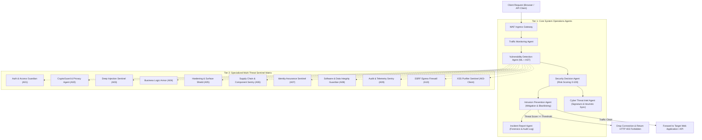

# Suraksha-AI Autonomous Web Defense Framework
## Comprehensive Architecture & Agent Operations Report

> [!IMPORTANT]
> **Suraksha-AI** implements a two-tier defense architecture comprising **Tier 1: Core System & Pipeline Operations Agents** for traffic interception, ML inference, decisioning, and mitigation, and **Tier 2: Specialized Multi-Threat Sentinel Agents** for deep semantic protection against OWASP Top 10 (2021) attack vectors.

---

## 1. System Defense Architecture Overview

When an HTTP/HTTPS request hits a protected web application, it traverses Suraksha-AI's autonomous defense pipeline. Inbound requests are analyzed concurrently across machine learning models and heuristic AST parsers, passing through specialized sentinels before being permitted or blocked.

---

## 2. Tier 1: Core System & Pipeline Operations Agents

These six agents manage the real-time request lifecycle, automated policy enforcement, machine learning inference, and forensics generation.

| Agent Name | Identifier | Default Priority | Primary Responsibility | Mitigation Mechanism |
| :--- | :--- | :--- | :--- | :--- |
| **Traffic Monitoring Agent** | `TrafficMonitoringAgent` | `High` | Continuous stream inspection, request rate tracking, header profiling, IP geolocation parsing. | Anomaly alerting, IP velocity rate-limiting, and traffic baseline deviation detection. |
| **Vulnerability Detection Agent** | `VulnerabilityDetectionAgent` | `Critical` | Payload tokenization, Abstract Syntax Tree (AST) inspection, and ML-based behavioral anomaly scoring. | Dual-model heuristic and neural inference classifying malicious patterns. |
| **Security Decision Agent** | `SecurityDecisionAgent` | `Critical` | Multi-agent telemetry aggregation, confidence fusion, and dynamic risk scoring (0.0 to 100.0). | Threshold arbitration: determines pass, challenge (CAPTCHA), or block disposition. |
| **Intrusion Prevention Agent** | `IntrusionPreventionAgent` | `Critical` | Immediate interception enforcement on threats flagged by the Decision Agent. | Active connection termination, HTTP 403 response generation, and dynamic firewall IP quarantine. |
| **Cyber Threat Intel Agent** | `CyberThreatIntelAgent` | `Medium` | Continuous ingestion of threat intelligence indicators, CVE updates, and hash correlations. | Updating heuristic signatures, blacklisted subnets, and known exploit patterns. |
| **Incident Report Agent** | `IncidentReportAgent` | `Low` | Structured incident logging, compliance evidence collection, and automated post-mortem generation. | Writing tamper-resistant audit logs to persistent storage (`suraksha.db`) and generating security summaries. |

---

## 3. Tier 2: Specialized Multi-Threat Sentinel Agents

The Sentinel Grid provides contextual domain defenses aligned with the **OWASP Top 10 (2021)** standards. Each sentinel monitors specific parameter spaces, protocols, and syntax semantics.

### 3.1. Auth & Access Guardian Agent
* **OWASP Classification**: `A01:2021 – Broken Access Control`
* **Shield Type**: Identity & Scope Authorization Firewall
* **Core Responsibilities**:
  * Prevents Insecure Direct Object References (IDOR) by validating session scope against requested entity identifiers (`/api/users/{id}/invoice`).
  * Detects privilege escalation attempts via parameter tampering (e.g., `is_admin=true`, `role=superuser`).
  * Blocks administrative path manipulation and unauthorized directory forced-browsing.
* **Defense Action**: Strict RBAC Enforcement & Object Scope Boundary Lock.

### 3.2. CryptoGuard & Data Privacy Agent
* **OWASP Classification**: `A02:2021 – Cryptographic Failures`
* **Shield Type**: Cryptographic Assurance & Data Masking Shield
* **Core Responsibilities**:
  * Inspects connection metadata to enforce HTTP Strict Transport Security (HSTS) and modern TLS protocols.
  * Intercepts cleartext password or credential transmissions sent over unencrypted channels.
  * Detects weak or deprecated cryptographic cipher requests (DES, RC4, MD5) and token entropy flaws.
* **Defense Action**: Strict Transport Security Enforcement & Sensitive Token Encryption Validation.

### 3.3. Deep Injection Sentinel Agent
* **OWASP Classification**: `A03:2021 – Injection` (SQLi, NoSQL, OS Command, LDAP)
* **Shield Type**: Multi-Syntax Injection & Payload Barrier
* **Core Responsibilities**:
  * Analyzes SQL query structures for tautology bypasses (`' OR '1'='1' --`), UNION-based extraction, and stacked queries.
  * Detects OS command chaining characters (`;`, `&&`, `|`, `` ` ``, `$()`) attempting shell execution.
  * Neutralizes LDAP special characters (`*`, `(`, `)`, `\`, `NUL`) and NoSQL operator injections (`$gt`, `$ne`).
* **Defense Action**: Context-Aware AST Inspection & Prepared Parameter Binding Enforcement.

### 3.4. Business Logic Armor Agent
* **OWASP Classification**: `A04:2021 – Insecure Design`
* **Shield Type**: State Machine & Business Constraint Sentinel
* **Core Responsibilities**:
  * Validates server-side business invariants, preventing negative quantity/pricing tampering (`quantity=-5`).
  * Identifies coupon stacking, workflow skipping, and checkout manipulation attempts.
  * Throttles automated OTP / verification code brute-forcing before logic depletion.
* **Defense Action**: Server-Side Invariant Validation & Financial Transaction Sanity Interception.

### 3.5. Hardening & Surface Shield Agent
* **OWASP Classification**: `A05:2021 – Security Misconfiguration`
* **Shield Type**: Environment & Server Hardening Perimeter
* **Core Responsibilities**:
  * Quarantines probes targeting exposed configuration or environment files (`/.env`, `/.git/config`, `/wp-config.php.bak`).
  * Blocks requests probing administrative actuator endpoints (`/actuator/health`, `/server-status`) with verbose debugging enabled.
  * Prevents exploitation attempts using default or well-known system credentials.
* **Defense Action**: Sensitive Endpoint Blackholing & Verbose Stack-Trace Error Shielding.

### 3.6. Supply Chain & Component Sentry
* **OWASP Classification**: `A06:2021 – Vulnerable and Outdated Components`
* **Shield Type**: Virtual Patching & Dependency Shield
* **Core Responsibilities**:
  * Intercepts known Remote Code Execution (RCE) signatures (e.g., Log4Shell `${jndi:ldap://...}`, Apache Struts OGNL expressions).
  * Implements real-time virtual patching for vulnerable server dependencies before upstream code updates can be deployed.
  * Filters malicious payload headers targeting vulnerable server runtimes.
* **Defense Action**: Virtual Patching & Known-CVE Signature Neutralization.

### 3.7. Identity Assurance & BruteForce Sentinel
* **OWASP Classification**: `A07:2021 – Identification and Authentication Failures`
* **Shield Type**: Adaptive Identity & Authentication Armor
* **Core Responsibilities**:
  * Monitors authentication endpoints for credential stuffing and high-velocity dictionary attacks.
  * Identifies session fixation attempts (e.g., pre-set `JSESSIONID` / session cookie parameters).
  * Enforces credential throttling, session token invalidation upon privilege transition, and MFA triggers.
* **Defense Action**: Adaptive Credential Throttling & Session Fixation Quarantine.

### 3.8. Software & Data Integrity Guardian
* **OWASP Classification**: `A08:2021 – Software and Data Integrity Failures`
* **Shield Type**: Integrity Verification & Deserialization Quarantine
* **Core Responsibilities**:
  * Intercepts untrusted object deserialization payloads (e.g., Java `rO0AB...` binary streams, Python pickle injections).
  * Validates JSON Web Token (JWT) cryptographic signatures and outright rejects `alg: none` bypass tokens.
  * Detects unsigned code and tampered data structures before parsing.
* **Defense Action**: Cryptographic Signature Verification & Deserialization Payload Quarantine.

### 3.9. Audit & Telemetry Sentry Agent
* **OWASP Classification**: `A09:2021 – Security Logging and Monitoring Failures`
* **Shield Type**: Audit Stream Integrity & Telemetry Shield
* **Core Responsibilities**:
  * Sanitizes all user-controlled input strings before they enter logging pipelines, stripping Carriage Return (`\r`) and Line Feed (`\n`) characters to prevent Log Injection / Log Splitting.
  * Detects and blocks automated security vulnerability scanners by matching signature profiles (e.g., `sqlmap`, `nikto`, `acunetix`).
  * Ensures audit integrity with immutable, append-only security logs.
* **Defense Action**: Log Stream Sanitization, Scanner Interception & Anti-Tamper Audit Lock.

### 3.10. SSRF Egress Firewall Agent
* **OWASP Classification**: `A10:2021 – Server-Side Request Forgery (SSRF)`
* **Shield Type**: Network Egress Gateway & Protocol Shield
* **Core Responsibilities**:
  * Intercepts URL parameters and outgoing webhook calls targeting cloud instance metadata APIs (`http://169.254.169.254/`).
  * Blocks egress requests targeting loopback addresses (`127.0.0.1`, `localhost`) and private subnets (`10.0.0.0/8`, `172.16.0.0/12`, `192.168.0.0/16`).
  * Enforces protocol allowlists, blocking sensitive protocols such as `gopher://`, `dict://`, and `file://`.
* **Defense Action**: Cloud Metadata Dropper & RFC-1918 Private Network Egress Quarantine.

### 3.11. XSS Purifier Sentinel Agent
* **OWASP Classification**: `A03:2021 – Cross-Site Scripting (XSS)`
* **Shield Type**: Client Script Context Barrier
* **Core Responsibilities**:
  * Scans form inputs, query parameters, and JSON payloads for inline scripts (``).
  * Neutralizes dangerous DOM event handlers (`onload=`, `onerror=`, `onmouseover=`).
  * Neutralizes pseudo-protocols (`javascript:...`, `data:text/html;base64,...`) and enforces strict Content Security Policy (CSP) headers.
* **Defense Action**: Context-Aware HTML/DOM Sanitization & Browser Script Execution Quarantine.

---

## 4. Agent Operations & Telemetry Matrix

| Agent | Inbound Target | Execution Latency | Interception Disposition |
| :--- | :--- | :--- | :--- |
| **Traffic Monitoring** | All HTTP Connections | `< 1.2 ms` | Baseline Profiled |
| **Vulnerability Detection** | URL, Headers, Body, Cookies | `< 3.5 ms` | Evaluated / Classified |
| **Security Decision** | Aggregate Sentinel Scores | `< 0.8 ms` | Risk Scoring (0–100) |
| **Intrusion Prevention** | Flagged Threat Requests | `< 0.5 ms` | HTTP 403 Forbidden / IP Drop |
| **Multi-Threat Sentinels** | OWASP Vector Contexts | `< 2.1 ms` | AST Inspection / Virtual Patch |

---

## 5. Security Recommendations for Ongoing Defense

1. **Keep Agent Registry Active**: Ensure all 6 core pipeline agents remain enabled in `Backend/agents/config.json`.
2. **Periodic Threat Feed Synchronization**: Schedule the `CyberThreatIntelAgent` to pull new CVE indicators weekly.
3. **Audit Log Retention**: Review SQLite logs (`suraksha.db`) generated by the `IncidentReportAgent` to verify baseline traffic stability.
